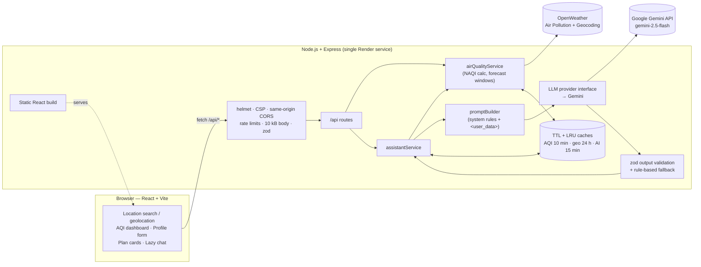

# 🌫️ SmogSense — AI Air Quality Assistant for Families


> **Hack2skill PromptWars — Challenge 6: Urban Air Quality Assistant**
>
> **Live demo:** `https://<your-service>.onrender.com` _(add after deploying — see [Deploy](#-deploy-to-render-free))_

SmogSense helps families and communities get through severe winter smog. It combines **live air-quality data**
with **Google Gemini** to produce a personalised, bilingual (English / हिन्दी) plan. The plan covers what to do today, how to
clean the air at home, and which sustainable choices cut pollution. **Every suggestion explains its direct
impact**, with honestly labelled estimates.

---

## 📋 Problem statement

> Create a GenAI-powered assistant that helps families and communities navigate severe winter smog and urban air
> pollution. The application should suggest low-emission daily routines, indoor air quality hacks, and sustainable
> alternatives tailored to their location and lifestyle, while clearly explaining the direct impact of their choices.

## ✨ Features

| #   | Feature                  | Details                                                                                                                                                                                                                                                                                          |
| --- | ------------------------ | ------------------------------------------------------------------------------------------------------------------------------------------------------------------------------------------------------------------------------------------------------------------------------------------------ |
| 1   | **Location**             | Debounced city search (OpenWeather Geocoding) or **Use my location** (browser geolocation, with clear messages when permission is denied or unsupported).                                                                                                                                        |
| 2   | **Live AQI dashboard**   | AQI on India's **NAQI 0–500 scale** computed from live concentrations; PM2.5, PM10, NO₂, O₃, CO, SO₂; category shown with **colour _and_ text**; a plain-language health message; the **cleanest and most polluted 3-hour windows** from the 24 h forecast.                                      |
| 3   | **Lifestyle profile**    | Household members (children, older adults, asthma/lung, heart conditions, pregnancy), commute mode, cooking fuel, heating, purifier/plants, work-from-home, plus an optional note. Saved only in your browser.                                                                                   |
| 4   | **AI personalised plan** | Gemini generates a **low-emission daily routine**, **indoor air-quality hacks** and **sustainable alternatives**. Each card has an **Impact** block: whether it lowers _exposure_, _emissions_ or both, why, an approximate estimate (e.g. "~40–60% lower indoor PM2.5") and a confidence level. |
| 5   | **Chat follow-ups**      | Ask "Can my kid play outside at 5pm?". The answer uses your live AQI, forecast windows and profile.                                                                                                                                                                                              |
| 6   | **Bilingual**            | English / हिन्दी toggle for the UI **and** AI output; `<html lang>` updates for screen readers.                                                                                                                                                                                                   |
| 7   | **Safety first**         | Urgent precautions banner for _Very poor / Severe_ air, "consult a doctor" guidance, and a clear **not medical advice** disclaimer.                                                                                                                                                              |
| ➕  | **Graceful degradation** | If OpenWeather fails, a clear message with **Try again**. If Gemini fails, schema-valid **rule-based guidance**, clearly labelled.                                                                                                                                                               |

### 📸 Screenshots

<!-- Add small (< 300 KB) PNGs to docs/screenshots/ and uncomment. -->
<!--  -->
<!--  -->
<!--  -->

_Screenshots coming soon._

---

## 🤖 Where and how Generative AI (Google Gemini) is used

Gemini is the **core engine** of the product. Without it there is no personalised plan or chat.

| Where                                                                                           | What Gemini does                                                                                                             | How                                                                                                                         |
| ----------------------------------------------------------------------------------------------- | ---------------------------------------------------------------------------------------------------------------------------- | --------------------------------------------------------------------------------------------------------------------------- |
| `POST /api/plan` → [`assistantService.generatePlan`](server/src/services/assistantService.js)   | Writes the personalised plan (3 sections, 3–5 suggestions each, every one with an impact explanation) in the chosen language | `gemini-2.5-flash` via `@google/genai`, **structured output** (`responseMimeType: application/json` + `responseJsonSchema`) |
| `POST /api/chat` → [`assistantService.answerQuestion`](server/src/services/assistantService.js) | Answers follow-up questions using live AQI, forecast windows, household profile and recent conversation                      | Same structured-output approach with a small `{ answer, safetyNote }` schema                                                |

**Pipeline**

1. The server fetches live AQI and the forecast itself; it never trusts AQI sent by the browser.
2. [`promptBuilder.js`](server/src/services/promptBuilder.js) puts **fixed rules in the system instruction**: safety, honesty about uncertainty, language, and output format.
3. All user-controlled data goes, JSON-serialised, inside one `<user_data>` block that the model is told to treat as data only.
4. Gemini returns JSON constrained by the schema in [`aiSchemas.js`](server/src/utils/aiSchemas.js).
5. The server **re-validates** it with zod, truncating over-long lists and rejecting anything malformed.
6. React renders the result as **plain-text cards**. Raw model HTML is never rendered: no `dangerouslySetInnerHTML` anywhere.
7. Results are cached for 15 minutes. Any model failure falls back to labelled rule-based guidance.

The LLM sits behind a one-method interface ([`services/llm/index.js`](server/src/services/llm/index.js)), so another provider can be swapped in without touching routes or services.

---

## 🏗️ Architecture



```
smogsense/
├─ shared/                # @smogsense/shared — constants used by BOTH server and client
│  └─ src/index.js        # languages, profile options, limits, AQI/plan vocabulary
├─ server/
│  ├─ src/
│  │  ├─ config/          # validated env config (zod)
│  │  ├─ middleware/      # security, validation, error handling
│  │  ├─ routes/          # thin API handlers
│  │  ├─ services/        # openWeatherClient, airQualityMappers (pure), airQualityService,
│  │  │                   # assistantService, promptBuilder, fallbackPlan/Content, llm/
│  │  ├─ utils/           # aqi maths, cache, validation & AI schemas, logger, errors
│  │  ├─ app.js           # app factory (dependency-injectable)
│  │  └─ index.js         # entry point
│  └─ tests/              # Vitest + Supertest (no network)
├─ client/
│  └─ src/
│     ├─ api/             # fetch wrapper, ApiError, shared request payload
│     ├─ hooks/           # useAssistantFlow, useAsyncState, useAbortableRequest, useCitySearch, useChat…
│     ├─ components/      # small presentational components (App is layout only)
│     ├─ i18n/            # en.js / hi.js (key parity enforced by tests)
│     ├─ styles/  utils/
│     └─ test/            # RTL setup + axe helper
├─ .github/workflows/ci.yml
├─ render.yaml
└─ .env.example
```

---

## ✅ How SmogSense meets the six judging criteria

### 1. Code quality

- **Quality is enforced, not just claimed.** [`eslint.config.js`](eslint.config.js) fails the build when a source function is over **60 lines**, has **cyclomatic complexity > 10**, more than **4 parameters**, nesting deeper than 3, nested ternaries, shadowed variables or reassigned parameters. Currently: **0 errors, 0 warnings**.
- **Complete JSDoc, verified by lint**: `eslint-plugin-jsdoc` requires a JSDoc block with `@param` and `@returns` on every exported function, hook and component, and checks that the types are valid.
- **No duplication across the stack**: a `shared/` workspace package is the single source of truth for languages, profile options, limits, pollutants, AQI levels and plan sections. Server validation and the client form import the same constants, and a contract test proves the server defaults equal the client's `DEFAULT_PROFILE`.
- Clear separation of concerns: **routes → services → utils** on the server. OpenWeather I/O ([`openWeatherClient.js`](server/src/services/openWeatherClient.js)) is split from pure mapping ([`airQualityMappers.js`](server/src/services/airQualityMappers.js)). Plan and chat share **one** AI pipeline driven by task descriptors ([`assistantService.js`](server/src/services/assistantService.js)).
- On the client, logic lives in **custom hooks**: `useAssistantFlow`, `useAsyncState`, `useAbortableRequest`, `useCitySearch` and `useChat`. Components are small and presentational, and `App` is layout only.
- Centralised **config** ([`config/index.js`](server/src/config/index.js), zod-validated) and **error handling** ([`errorHandler.js`](server/src/middleware/errorHandler.js)). Consistent naming: `createX` factories, `useX` hooks, `toX` mappers, `buildX` builders.
- **ESLint 9** (React, hooks, **jsx-a11y strict**, jsdoc) and **Prettier**, both enforced in CI.

### 2. Security

- **helmet** with a strict CSP (`script-src 'self'`, no inline scripts in the build), HSTS, `frame-ancestors 'none'`, plus a `Permissions-Policy` that allows geolocation for our own origin only.
- **CORS restricted to our own origin.** Requests from foreign browser origins are rejected with **403**, not merely left without CORS headers.
- **express-rate-limit** on `/api` (100 / 15 min), stricter on AI routes (20 / 15 min). **10 kB** JSON body limit.
- **zod validation** of every input: lat/lon ranges, enums, `.strict()` objects (unknown keys rejected), length limits, control characters and `<>` stripped from free text.
- **Prompt-injection hardening**: rules live only in the system instruction; user text sits only inside a delimited data block; the model is told to ignore instructions there; output is schema-constrained and re-validated.
- **Secrets stay server-side**: the browser only calls our API. API keys are never logged, and the logger never receives upstream URLs. Clients get generic error messages; details go to server logs.
- `npm audit`: **0 vulnerabilities**. It runs in CI and fails on high/critical findings.

### 3. Efficiency

- **TTL + LRU caches with in-flight de-duplication**: AQI per ~1 km cell for 10 min, geocoding for 24 h, AI responses for 15 min. Concurrent identical requests share one upstream call.
- Current AQI, forecast and reverse geocoding are fetched **in parallel**. Gemini 2.5 Flash runs with thinking disabled for low latency.
- Frontend: **debounced search** with request cancellation (`AbortController`), **lazy-loaded chat** (separate ~1 kB chunk), `memo` on heavy components, loading **skeletons**, **no UI libraries** (≈81 kB gzipped JS, mostly React).
- Server: gzip **compression**, `immutable` 1-year caching for hashed assets, `Cache-Control` on API responses.

### 4. Testing

- **191 automated tests** (Vitest), with no network calls in tests.
  - **Server (128):** AQI maths, OpenWeather mappers, client/server contract, cache (TTL/LRU/dedupe), input validation, prompt builder (injection containment), AI response parsing, OpenWeather service (mocked fetch), assistant service (mocked LLM, fallbacks), Gemini provider, config, and **Supertest integration** for every route covering CORS, rate limits, body limits, error hiding and SPA hosting.
  - **Client (63):** React Testing Library tests for the profile form, AQI card, plan rendering (including an HTML-injection test), location search (debounce, geolocation allowed/denied/unsupported), chat, error and loading states, a full App flow, and **axe-core accessibility checks** on every main component and the full page.
- Coverage is about **97% of statements** on both server and client.
- `npm test` at the root runs everything. **GitHub Actions** runs lint, format check, tests with coverage, build and audit on every push.

### 5. Accessibility (WCAG 2.1 AA)

- Semantic landmarks (`header`, `main`, `footer`), logical heading order, a **skip link**, and `lang` attributes for Hindi content.
- **Every input has a label**; checkbox groups use `fieldset`/`legend`; hints are tied in with `aria-describedby`.
- **Visible `:focus-visible` rings**; full keyboard operation (tested); focus moves to the plan when it's ready.
- **`aria-live` regions** for search status, loading, AI responses (`role="log"`) and errors (`role="alert"`).
- AQI is **never shown by colour alone**; every colour pair meets ≥ 4.5:1 contrast. The app respects `prefers-reduced-motion` and `forced-colors`, uses 44 px touch targets, and is mobile-first.
- Automated checks: **axe-core** in tests and **eslint-plugin-jsx-a11y (strict)** in lint.

### 6. Problem statement alignment

| Requirement                          | Where                                                                                            |
| ------------------------------------ | ------------------------------------------------------------------------------------------------ |
| Severe winter smog / urban pollution | Live AQI with India NAQI categories up to **Severe**, plus urgent-precaution banner              |
| Low-emission daily routines          | Plan → _Low-emission daily routine_, grounded in real **forecast windows**                       |
| Indoor air quality hacks             | Plan → _Indoor air quality hacks_ (ventilation timing, DIY filters, purifier, no incense/frying) |
| Sustainable alternatives             | Plan → _Sustainable alternatives_ (transit, carpool, clean cooking, no waste burning)            |
| Tailored to location                 | Live AQI and forecast for the chosen city or GPS position                                        |
| Tailored to lifestyle                | Household, commute, fuel, heating and equipment feed the prompt                                  |
| Clearly explain direct impact        | **Mandatory `impact` object on every suggestion**, enforced by schema                            |
| Families & communities               | Vulnerable-member awareness, Hindi support, community actions such as reporting open burning     |

---

## 🚀 Getting started (local)

**Prerequisites:** Node.js 22+, a free [Gemini API key](https://aistudio.google.com/apikey) and a free [OpenWeather API key](https://home.openweathermap.org/api_keys).

```bash
git clone <your-repo-url> smogsense && cd smogsense
npm install                 # installs server + client (npm workspaces)
cp .env.example .env        # then add your keys
```

Run in two terminals:

```bash
npm run dev:server          # Express API on http://localhost:8080
npm run dev:client          # Vite on http://localhost:5173 (proxies /api)
```

Or run the production build locally:

```bash
npm run build && NODE_ENV=production npm start   # http://localhost:8080
```

> The app runs without keys too. AQI shows a clear "not configured" message and the plan uses labelled fallback guidance.

### Environment variables

| Variable                               | Required   | Default            | Description                                |
| -------------------------------------- | ---------- | ------------------ | ------------------------------------------ |
| `GEMINI_API_KEY`                       | ✅ for AI  | —                  | Google AI Studio key (free tier)           |
| `GEMINI_MODEL`                         |            | `gemini-2.5-flash` | Gemini model ID                            |
| `OPENWEATHER_API_KEY`                  | ✅ for AQI | —                  | OpenWeather key (free tier)                |
| `PORT`                                 |            | `8080`             | HTTP port (Render sets this automatically) |
| `NODE_ENV`                             |            | `development`      | `production` disables the dev CORS origin  |
| `ALLOWED_ORIGINS`                      |            | —                  | Extra comma-separated CORS origins         |
| `RATE_LIMIT_MAX` / `AI_RATE_LIMIT_MAX` |            | `100` / `20`       | Requests per 15 minutes per IP             |

## 🧪 Running tests

```bash
npm test                    # all server + client tests
npm run test:coverage       # with coverage reports
npm run lint                # ESLint (incl. jsx-a11y strict)
npm run format:check        # Prettier
```

## ☁️ Deploy to Render (free)

**Option A — Blueprint (recommended)**

1. Push this repo to GitHub as a **public** repository.
2. In Render choose **New → Blueprint** and select the repo. Render reads [`render.yaml`](render.yaml).
3. When prompted, enter `GEMINI_API_KEY` and `OPENWEATHER_API_KEY`, then click **Apply**.
4. After the build, open `https://<service>.onrender.com` and add the URL to the top of this README.

**Option B — Manual web service**

- **Runtime:** Node · **Plan:** Free
- **Build command:** `npm ci --include=dev && npm run build`
- **Start command:** `npm start`
- **Health check path:** `/api/health`
- **Environment:** `NODE_ENV=production`, `GEMINI_API_KEY`, `OPENWEATHER_API_KEY`

> Free Render services sleep after inactivity, so the first request can take ~30–50 s.

---

## ⚠️ Disclaimer

SmogSense provides **general information only and is not medical advice**. AQI values are approximate: they are
computed from current concentrations, while official NAQI uses 24-hour averages. All impact figures are estimates. AI-generated
suggestions may contain mistakes. **If you or a family member has breathlessness, chest pain, dizziness or a persistent
cough, consult a doctor.** For official data, refer to CPCB / your local pollution control board.

## 📄 License

[MIT](LICENSE) · Data: [OpenWeather](https://openweathermap.org/api/air-pollution) · AI: [Google Gemini](https://ai.google.dev/)
